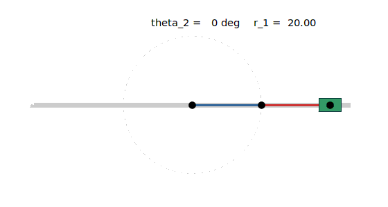
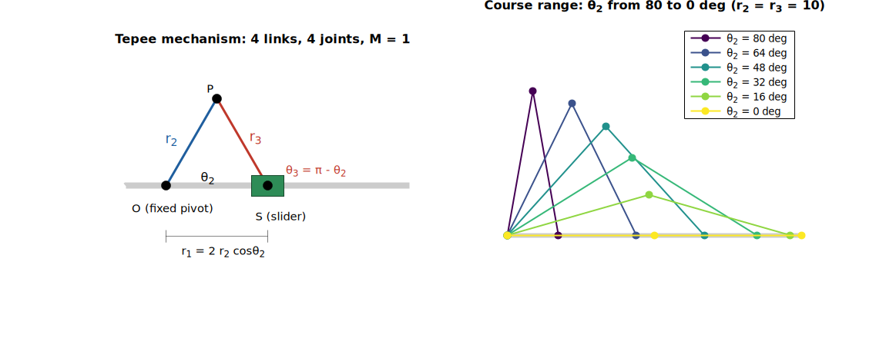
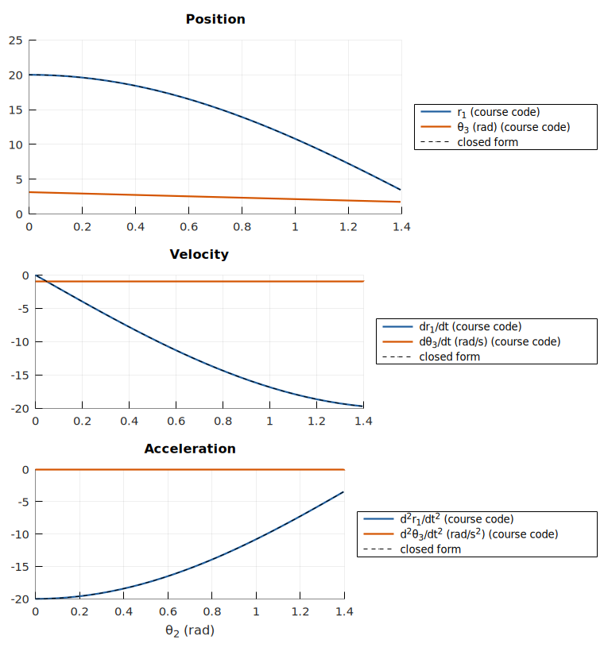
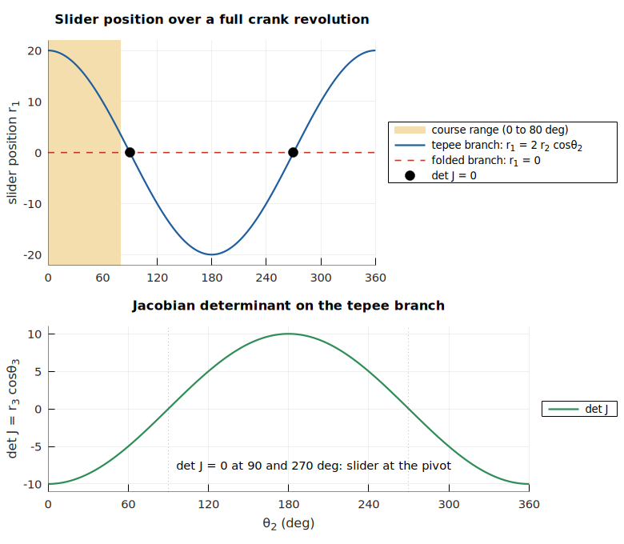
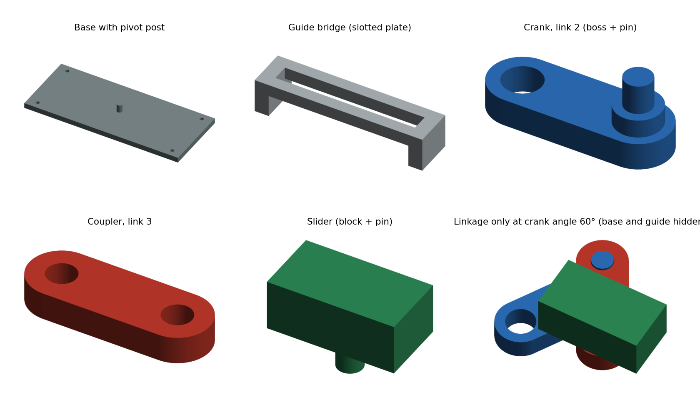
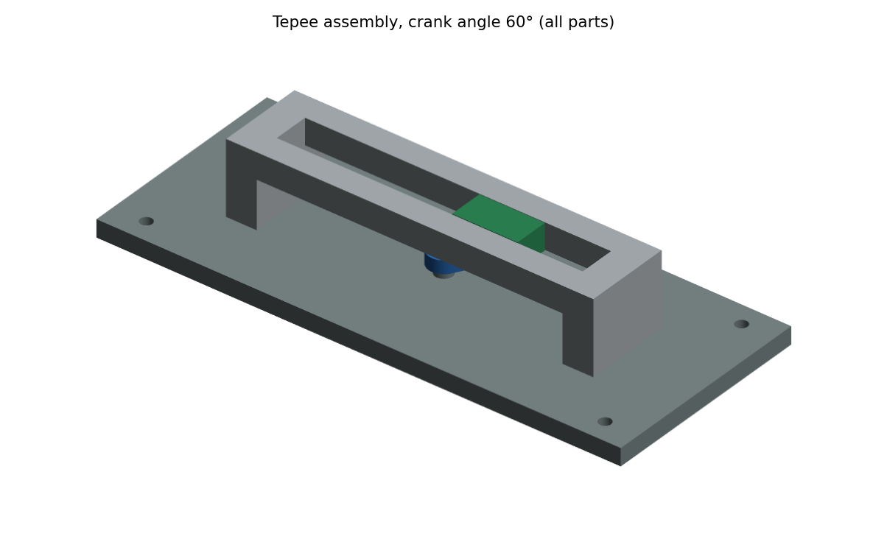

# 1-DOF Tepee Mechanism: Kinematic Analysis

Kinematic analysis of a 1-DOF tepee (equal-length slider-crank) linkage, with a closed-form check, a full-revolution study in Python and a parametric CAD model with a motion check.

The core analysis started as a group project in **ME 4504, Mechanics of Machines Lab** (Department of Mechanical and Production Engineering, Islamic University of Technology), submitted by Group 4. I later revisited that work:
- corrected and generalised the MATLAB code;
- verified it against the closed-form solution;
- extended the analysis to a full crank revolution in Python;
- modelled the linkage in CAD and checked it for interference through a full revolution.

<p align="center"></p>

## The mechanism

A crank **r₂** turns about a fixed pivot O. A coupler **r₃** of the same length joins the crank tip P to a slider S that moves along the line through O. The linkage has four links and four one-degree-of-freedom joints (three revolute, one prismatic). Kutzbach’s equation therefore gives M = 3(4 − 1) − 2·4 = **1**, so the input angle θ₂ alone fixes the motion.

<p align="center"></p>

Because r₂ = r₃, triangle OPS is isosceles and the slider motion is exactly harmonic: **r₁ = 2 r₂ cos θ₂**, with θ₃ = π − θ₂. This is the same output as a Scotch yoke, which is why the mechanism is sometimes compared to one. It is a linkage, though, not a pin-in-slot yoke (see the comparison below).

## Kinematic analysis

The vector loop, split into x and y components, has two unknowns, r₁ and θ₃:

r₁ − r₂ cos θ₂ + r₃ cos θ₃ = 0  and  −r₂ sin θ₂ + r₃ sin θ₃ = 0

- **Position:** solved with Newton’s method, warm-started from the previous angle.
- **Velocity:** differentiating the loop gives J·[ṙ₁; θ̇₃] = [−r₂ sin θ₂ θ̇₂; r₂ cos θ₂ θ̇₂], with J = [1, −r₃ sin θ₃; 0, r₃ cos θ₃].
- **Acceleration:** differentiating again gives the matching equation with the same J.
- **Closed form for r₂ = r₃:** ṙ₁ = −2 r₂ sin θ₂ θ̇₂, r̈₁ = −2 r₂ cos θ₂ θ̇₂², θ̇₃ = −θ̇₂.

This is a **kinematic** analysis (position, velocity and acceleration). Forces and torques are not analysed.

**Inputs (course case):** r₂ = r₃ = 10 mm, θ₂ from 80° to 0° in 30 frames, θ̇₂ = 1 rad/s, θ̈₂ = 0.

| θ₂ | r₁ (mm) | ṙ₁ (mm/s) | r̈₁ (mm/s²) |
|---|---|---|---|
| 80° | 3.47 | −19.70 | −3.47 |
| 0° | 20.00 | 0.00 | −20.00 |

<p align="center"></p>

*Course code results with the closed-form curves dashed.*

### Verification

I compared both versions of the code with the closed-form solution over all 30 frames:

| Quantity | Course code (Newton tol 10⁻³) | Revised code (Newton tol 10⁻¹⁰) |
|---|---|---|
| r₁ (mm) | 9 × 10⁻⁴ | 1 × 10⁻¹⁰ |
| θ₃ (rad) | 9 × 10⁻⁵ | 9 × 10⁻¹² |
| ṙ₁ (mm/s) | 4 × 10⁻³ | 2 × 10⁻¹⁰ |
| r̈₁ (mm/s²) | 9 × 10⁻⁴ | 5 × 10⁻¹⁰ |

### What I changed in the code

The original acceleration step used `inv(J).*ba`, an element-wise product instead of a matrix solve. It happens to give the right answer when r₂ = r₃. With r₃ = 1.2 r₂, however, it gives r̈₁ = −32.0 where the correct value is −9.0. `matlab/tepee_kinematics.m` therefore:
- solves `J \ ba` as a matrix equation;
- corrects the sign of the θ̈₂ term;
- caps the Newton loop at 50 iterations, because J is singular when cos θ₃ = 0.

For unequal links (r₃ = 1.2 r₂, θ̈₂ ≠ 0), the revised function agrees with finite differences of the position, so it works beyond the course case. Details are in [`matlab/README.md`](matlab/README.md).

## Beyond the course range

I ran the crank through a full revolution in Python (`python/tepee_analysis.py`). The slider follows r₁ = 2 r₂ cos θ₂ over 360°, a stroke of 4 r₂.

<p align="center"></p>

- **Singular points at θ₂ = 90° and 270°.** Here the slider reaches the crank pivot and det J = r₃ cos θ₃ = 0. At these angles the tepee configuration meets a second assembly mode: r₁ = 0, with link 3 folded onto link 2 (θ₃ = θ₂). Starting Newton’s method from a different guess finds that mode.
- **The course range avoids them.** 80° to 0° never reaches a singular point. For the linkage to pass through these points, the slider and coupler must run in a different plane from the crank, and I laid out the CAD that way.

## CAD

<p align="center"></p>
<p align="center"></p>

I modelled the linkage parametrically in Python with CadQuery at r₂ = r₃ = 25 mm (2.5 × the course dimensions), which gives a slider stroke of 100 mm. Every dimension is a parameter at the top of [`cad/tepee/build_tepee.py`](cad/tepee/build_tepee.py). The parts are stacked in layers (z, mm):

| Layer | z (mm) |
|---|---|
| Base | 0–8 |
| Crank | 12–18, boss to 22 |
| Coupler | 22–28 |
| Slider and guide plate | 30–42 |

| Part | Volume | Description |
|---|---|---|
| Base | 191.8 cm³ | 240 × 100 × 8 mm plate with a Ø8 pivot post and 4 mounting holes |
| Guide bridge | 77.4 cm³ | slotted plate on two end walls; carries the slider above the linkage |
| Crank (link 2) | 3.2 cm³ | 14 × 6 mm link with a boss and a Ø6 pin at P |
| Coupler (link 3) | 2.6 cm³ | same outline; two Ø6.3 holes 25 mm apart |
| Slider | 6.0 cm³ | 30 × 16 × 12 mm block with a Ø6 pin |

**Motion check.** I placed the assembly at 24 crank angles, 15° apart, around a full revolution, with the coupler and slider following the kinematics above. At every angle I measured the interference volume and the smallest gap between each pair of parts (`cad/tepee/check_motion.py`):

| Check | Result |
|---|---|
| Interference between any pair of the 5 parts | 0 mm³ at every angle |
| Pin-to-hole gap (crank pin and slider pin in the coupler) | 0.15 mm (design clearance) |
| Slider block to guide slot | 0.30 mm |
| Coupler to base and to guide bridge | 2.0 mm |
| Crank to guide bridge | 1.5 mm |
| Contact by design | bridge on base; coupler resting on the crank boss |

## Comparison with a Scotch yoke

[`cad/scotch_yoke_reference/`](cad/scotch_yoke_reference/) contains a pin-in-slot Scotch yoke with a 20 mm crank radius, so its yoke moves as x = 20 cos θ. That is exactly the motion of the tepee with r₂ = r₃ = 10; the two curves are identical over a full revolution.

| | Tepee linkage | Scotch yoke |
|---|---|---|
| Crank length for a given stroke | stroke / 4 | stroke / 2 |
| Output motion | exactly harmonic | exactly harmonic |
| Joints | revolute joints plus a sliding slider | sliding pin in a slot, two guide rods |
| Packaging | crank, coupler and slider in separate layers | crank and yoke plate in layers |

The tepee also has a straight-line property. A point on link 3, extended past P by r₃, moves on the straight line x = 0. This is the basis of the Scott Russell straight-line linkage.


## Reproducing the results
```
pip install -r requirements.txt

# MATLAB or GNU Octave (from matlab/)
validate_tepee
run_tepee_demo

# Python (from the repo root)
python python/tepee_analysis.py
python cad/tepee/build_tepee.py
python cad/tepee/check_motion.py
python python/render_tepee_cad.py
```

## Repository contents

```
├── matlab/                 course code (original_submission/, report_revised/), revised function, demo, validation, outputs/
├── python/                 closed-form check, full-revolution analysis, figures, CAD renders
├── cad/
│   ├── tepee/              parametric build script, motion check, STEP and STL of every part and the assembly
│   └── scotch_yoke_reference/   comparison mechanism
└── figures/  results/      images, CSV and JSON outputs used above
```

## Sources cited in the group report
